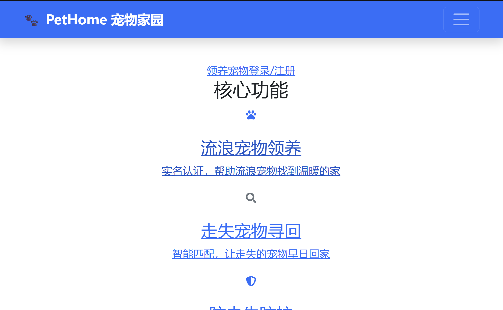
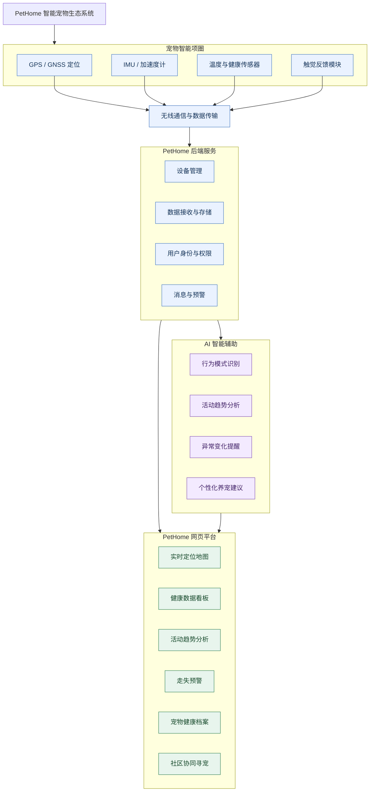

# PetHome

<div align="center">



<p>
  
</p>

> **演示说明：** GitHub 连接的 Netlify 项目目前没有可核验的部署记录，因此暂不提供在线演示入口。请以经现场确认的本地运行结果或后续正式部署地址为准。

<p>
  
  
  
  
  
</p>

<p>
  <a href="#项目简介">项目简介</a> •
  <a href="#项目当前状态">项目当前状态</a> •
  <a href="#快速开始">快速开始</a> •
  <a href="#贡献指南">贡献指南</a>
</p>

</div>

---

## 项目简介

**PetHome（宠物家园）** 是一个面向宠物主人、领养人和救助参与者的综合宠物服务平台项目。项目围绕宠物领养、医疗服务、流浪动物救助和社区交流等场景组织页面与后端业务代码，并计划逐步完善为可运行、可测试、可维护的智能宠物服务平台。

### PetHome 智能宠物生态系统总体架构（未来目标架构）

> <strong>未来目标架构：</strong> 下图展示 PetHome 计划逐步建设的“智能项圈 + 物联网数据平台 + Web 平台 + AI 智能辅助”整体方向。图中模块均为规划内容，不代表相关硬件、数据链路或功能已经实现或上线。



**数据链路说明：** 项圈传感器采集的数据需要经过通信链路传输至后端，再由后端按权限存储和提供给网页及 AI 服务。GPS 模块本身不会自动把位置发送到网页；实际通信方式、设备协议、数据安全和传感器准确性仍需后续设计与验证。

### 业务模块概览

为避免把页面数量误认为功能完成度，项目按业务方向归类展示：

| 业务方向 | 涵盖模块（以仓库页面/代码目录为线索） | 当前说明 |
|---|---|---|
| 核心业务方向 | 宠物领养、宠物医疗、流浪动物救助/走失寻回、社区交流 | 仓库包含相关页面或业务代码；各业务流程是否完整联调仍需逐项验证 |
| 扩展服务方向 | 宠物幼儿园、宠物店铺、同城约伴、宠物服务/训练、资助、宠物医药、防走失提醒 | 仓库包含相应页面或模块代码；不据此宣称所有服务已上线 |
| 平台基础能力 | 登录注册、个人资料、宠物档案、订单/预约等 | 以实际接口联调和运行测试结果为准 |

### 网站功能模块图（现有代码方向与未来规划）

> **阅读说明：** 此图根据仓库中可见的页面路由、API 和后端业务目录归纳。它展示的是项目功能组织方式，不代表每个模块都已完成前后端联调或通过验收。智能项圈、连续健康监测和 AI 分析属于未来规划。

```mermaid
flowchart TB
    U["用户 / 宠物主人 / 领养人 / 救助参与者"]
    U --> A["账户与个人中心"]
    U --> P["宠物管理"]
    U --> B["宠物服务与业务"]
    U --> C["社区互动"]
    U --> F["平台基础能力"]

    subgraph ACCOUNT["账户与个人中心"]
        A1["注册 / 登录"]
        A2["个人资料与隐私设置"]
        A3["通知 / 我的预约 / 我的订单"]
    end
    A --> A1
    A --> A2
    A --> A3

    subgraph PET["宠物管理"]
        P1["我的宠物 / 宠物档案"]
        P2["宠物资料维护"]
        P3["领养申请与记录"]
    end
    P --> P1
    P --> P2
    P --> P3

    subgraph SERVICE["宠物服务与业务"]
        B1["宠物领养"]
        B2["医疗服务与预约"]
        B3["走失发布与寻回"]
        B4["流浪动物救助 / 资助"]
        B5["宠物幼儿园与寄养"]
        B6["宠物店铺与用品"]
        B7["训练 / 专业服务"]
        B8["同城约伴"]
    end
    B --> B1
    B --> B2
    B --> B3
    B --> B4
    B --> B5
    B --> B6
    B --> B7
    B --> B8

    subgraph COMMUNITY["社区互动"]
        C1["动态发布"]
        C2["宠物相关内容交流"]
        C3["社交与互动"]
        C4["寻宠线索协作（规划深化）"]
    end
    C --> C1
    C --> C2
    C --> C3
    C --> C4

    subgraph PLATFORM["平台基础能力"]
        F1["前端页面与交互"]
        F2["业务 API 与后端服务"]
        F3["身份认证与权限控制"]
        F4["数据存储与文件上传"]
        F5["消息 / 实时通信（待逐项验证）"]
    end
    F --> F1
    F --> F2
    F --> F3
    F --> F4
    F --> F5

    subgraph FUTURE["未来扩展：智能项圈与 AI"]
        G1["设备绑定与定位地图"]
        G2["活动趋势与健康数据看板"]
        G3["电子围栏与异常提醒"]
        G4["AI 行为分析与养宠建议"]
    end
    P1 -. "未来扩展" .-> FUTURE

    classDef current fill:#e8f5ed,stroke:#38865a,color:#174b2c
    classDef foundation fill:#eaf2ff,stroke:#477ac3,color:#17365d
    classDef future fill:#f3eaff,stroke:#8554b5,color:#43236b
    class A1,A2,A3,P1,P2,P3,B1,B2,B3,B4,B5,B6,B7,B8,C1,C2,C3 current
    class F1,F2,F3,F4,F5 foundation
    class C4,G1,G2,G3,G4 future
```



**模块说明：**

| 模块分组 | 主要内容 | 当前状态说明 |
|---|---|---|
| 账户与个人中心 | 注册登录、个人资料、通知、预约和订单入口 | 仓库存在相关页面/代码，权限与业务闭环需测试 |
| 宠物管理 | 我的宠物、宠物资料、领养记录 | 仓库存在相关页面和后端模型/接口，需验证实际联通情况 |
| 宠物服务与业务 | 领养、医疗、走失寻回、救助、寄养、店铺、训练、约伴 | 仓库存在对应业务页面或代码，不能据此认定全部上线 |
| 社区互动 | 动态发布、内容交流和社交功能 | 仓库存在社区页面及相关后端代码，互动流程待验收 |
| 平台基础能力 | 前后端 API、认证、数据存储、文件上传和实时通信 | 需要按功能进行接口、权限和运行测试 |
| 智能项圈与 AI | 定位、健康看板、电子围栏、行为分析 | **未来规划，尚未作为真实设备能力上线** |

### 项目当前状态

- **代码与界面：** 仓库包含 Next.js 页面、组件及 Express/TypeScript 后端代码。
- **功能状态：** 页面或模块代码存在，不等于业务闭环已完成；接口、数据库和实时通信功能仍需按模块验证。
- **部署状态：** GitHub 连接的 Netlify 项目目前没有可核验的部署记录；在线部署暂不作为已完成成果展示。
- **AI 状态：** RAG、机器学习推荐、健康辅助和计算机视觉均属于后续规划，当前不作为已上线能力宣传。

### 项目特色与目标

- **多场景服务整合：** 以领养、医疗、救助和社区为核心，逐步连接其他宠物服务。
- **位置与资源匹配：** 规划结合位置、宠物特征和服务需求改善资源查找体验；实际接入状态待核验。
- **实时互动：** 仓库包含 Socket.IO 相关依赖和后端代码，端到端实时功能待验证。
- **安全与可维护性：** 持续完善认证授权、数据保护、测试和开发文档。


## PetHome V2.0：AI 智能化升级路线

PetHome 的长期目标是在现有宠物服务平台基础上，逐步建设为具备知识辅助、智能匹配和多模态能力的 AI 智能宠物服务平台。

> **状态说明：以下内容均为未来规划，不代表相关 AI 功能已经开发、接入真实模型或上线。**

### 四个重点方向

1. **AI 养宠知识助手（优先探索）**：采用 RAG（检索增强生成）思路，让回答结合经过筛选的宠物知识资料，并尽可能展示来源和依据。
2. **机器学习推荐与匹配**：探索领养、救助资源、同城约伴和用品推荐；先建立可解释的规则基线，再用合规数据验证机器学习是否有提升。
3. **AI 健康辅助**：帮助整理健康信息、生成就诊摘要和提供科普资料，不进行兽医诊断，不替代专业检查或治疗。
4. **计算机视觉拓展**：探索宠物图片特征提取和走失线索检索；相似度仅作为候选线索，必须由人确认。

### 分阶段建设路线

| 阶段 | 主要工作 | 阶段目标 |
|---|---|---|
| 1. 现有系统核查 | 确认正式前端入口、接口、数据和部署方式 | 形成可复核的系统现状清单 |
| 2. AI 基础准备 | 明确知识来源、隐私边界、模型服务接口和测试方法 | 建立安全、可评估的基础 |
| 3. RAG 知识助手 MVP | 整理知识资料、实现检索与回答原型 | 用测试集评估检索质量、引用和错误回答 |
| 4. 健康辅助与推荐实验 | 增加安全的信息整理能力，建立推荐规则基线和模型实验 | 记录对照指标、失败案例和人工复核 |
| 5. 视觉与全站集成 | 探索图片检索，逐步接入其他业务模块 | 完成独立测试、权限控制和验收 |

详细的 12 个业务模块 AI 设计、公共能力、技术选型和验收清单见 [PetHome V2.0 AI 升级规划](docs/AI_UPGRADE_PLAN.md)。

**技术真实性原则：** 规则匹配不等同于机器学习，静态页面不等同于 AI 功能。只有在代码实现、测试执行且验收证据可查后，才将规划状态更新为已实现或已验收。

### 智能项圈与物联网生态（长期规划）

PetHome 计划在现有宠物服务平台基础上，探索连接智能宠物项圈，逐步形成“宠物智能硬件 + Web 平台 + AI 辅助分析”的产品生态。该方向目前属于产品与技术规划，**尚不代表已有项圈设备、传感器数据链路或相关功能上线**。

规划中的项圈能力包括：

- **定位与防走失**：结合 GNSS/GPS、移动网络通信和网页地图，探索位置查看、历史轨迹、电子围栏及走失模式。定位频率、室内覆盖和网络可用性需要实测。
- **活动与行为记录**：利用三轴加速度计/IMU 记录活动变化，探索步行、奔跑、休息等行为分类，并生成周期报告。
- **健康数据档案**：在传感器适用且经过验证的前提下，探索心率、呼吸等指标的趋势记录；传感器读数不等同于兽医诊断。项圈温度读数也不能直接当作宠物核心体温。
- **环境安全提醒**：结合设备环境温度与天气信息提供高温、低温风险提示，并明确数据来源和适用范围。
- **智能舒适护理**：研究可拆卸、低强度、可手动关闭的触觉反馈模块；按摩或康复用途须经兽医/专业人员评估，不把振动功能宣传为治疗手段。
- **平台协同**：将设备数据与宠物档案、社区寻宠、家庭共享及专业服务预约等现有产品方向逐步连接。

硬件方向的详细设计、传感器边界、通信链路、安全要求和阶段计划见 [智能项圈与物联网生态规划](docs/AI_UPGRADE_PLAN.md#12-智能项圈与物联网生态规划)。

## 项目截图

> 以下图片用于展示仓库已有的界面设计与页面样例。截图不单独证明后端接口、数据库操作或完整业务流程已经通过验收。

<div align="center">

<table>
<tr>
<td align="center">
<h4>🏠 首页</h4>
<p>精美首页展示，功能入口一目了然，快速导航至各个服务模块</p>

</td>
<td align="center">
<h4>📝 申请领养</h4>
<p>在线提交领养申请，填写基本信息，等待审核反馈</p>

</td>
</tr>

<tr>
<td align="center">
<h4>📢 走失宠物发布</h4>
<p>发布走失宠物信息，上传照片和联系方式，扩大寻找范围</p>

</td>
<td align="center">
<h4>🔍 走失宠物查询</h4>
<p>查询附近走失宠物信息，提供线索帮助寻找</p>

</td>
</tr>

<tr>
<td align="center">
<h4>⏰ 防走丢提醒</h4>
<p>设置宠物信息提醒，走失时及时接收通知</p>

</td>
<td align="center">
<h4>🎓 宠物幼儿园</h4>
<p>宠物寄养服务，专业看护，让宠物安心度假</p>

</td>
</tr>

<tr>
<td align="center">
<h4>🛍️ 宠物店铺</h4>
<p>在线购物平台，宠物用品一站式采购</p>

</td>
<td align="center">
<h4>🤝 同城约伴</h4>
<p>约附近宠友一起遛弯，宠物社交新方式</p>

</td>
</tr>

<tr>
<td align="center">
<h4>💊 宠物医药</h4>
<p>宠物药品查询，在线预约兽医咨询服务</p>

</td>
<td align="center">
<h4>❤️ 宠物资助</h4>
<p>为流浪动物提供物资援助，传递爱心</p>

</td>
</tr>

<tr>
<td align="center">
<h4>🐕 训狗服务</h4>
<p>专业训狗师在线指导，解决养狗难题</p>

</td>
<td align="center">
<h4>💬 养宠社区</h4>
<p>分享养宠经验，与众多宠友交流心得</p>

</td>
</tr>
</table>

</div>

---

## 技术架构

### 前端技术栈

```
├───────────────────────────────────────────────
│                   前端 (Next.js 14)                      │
├───────────────────────────────────────────────────────────┤
│ • React 18          • TypeScript 5                      │
│ • Tailwind CSS      • Radix UI                          │
│ • Axios             • Socket.IO Client                  │
│ • React Bootstrap   • Lucide Icons                      │
└───────────────────────────────────────────────────────────┘
```

### 后端技术栈

```
├───────────────────────────────────────────────
│                  后端 (Node.js + Express)                │
├───────────────────────────────────────────────────────────┤
│ • TypeScript 5      • Express 4                         │
│ • MongoDB + Mongoose 8  • Socket.IO                     │
│ • JWT 认证          • bcrypt 加密                       │
│ • Helmet 安全       • CORS 跨域                         │
│ • Multer 文件上传   • Express Validator                 │
└───────────────────────────────────────────────────────────┘
```

### 当前代码逻辑架构（待运行核验）

```
浏览器用户
   │
   ▼
Next.js 前端页面与组件
   │ HTTP 请求 / Socket.IO（按具体功能核验）
   ▼
Express + TypeScript 后端
   │
   ▼
Mongoose 数据模型
   │
   ▼
MongoDB（连接配置与运行状态待核验）
```

> 这张图描述仓库代码中可识别的技术层次，不代表当前已成功部署或所有接口均已联通。正式前端入口、API 地址、数据库连接和实时通信仍需通过本地运行与测试确认。

### 未来目标架构（规划中）

```
浏览器 / 移动端
      │
      ▼
PetHome Web 前端
      │
      ▼
业务 API 与身份权限层
      ├────────► 数据库与文件存储
      ├────────► 实时消息服务
      └────────► 独立 AI 服务（规划中）
                    ├── RAG 知识检索
                    ├── 推荐与匹配模型
                    └── 宠物图片检索
```

> 未来架构仅表示目标方向。具体云服务、模型供应商、部署拓扑和数据存储方案需经调研与验证后确定。

---

## 项目目录概览

```
Pethome/
├── app/                    # 根目录 Next.js 页面结构（正式入口待核验）
├── components/             # 根目录共享组件
├── src/                    # 根目录源码相关目录
├── client/                 # 另一套 Next.js 前端结构（与根目录存在重复）
├── server/                 # Express + TypeScript 后端
│   └── src/
│       ├── controllers/
│       ├── models/
│       ├── routes/
│       └── middleware/
├── public/                 # 静态资源
├── docs/                   # 项目文档
│   ├── README.md           # 文档导航
│   ├── AI_UPGRADE_PLAN.md  # AI 升级详细规划
│   ├── user/               # 普通用户手册
│   └── developer/          # 开发者技术手册
├── netlify.toml            # 根目录部署配置（策略待核验）
├── client/netlify.toml     # client 部署配置（策略待核验）
├── README.md
└── 项目文档结构图与推进计划.md
```

> **重要说明：** 根目录与 `client/` 均存在前端项目文件，且两处 Netlify 配置策略不同。当前不据此认定正式构建入口，也不删除或合并任一目录。应在完成依赖、导入路径、本地构建和部署验证后再决定是否整合。

---

## 文档入口

- [项目文档中心](docs/README.md)
- [普通用户使用手册](docs/user/USER_MANUAL.md)（框架已建立，内容待实际功能核验）
- [开发者技术手册](docs/developer/DEVELOPER_GUIDE.md)（框架已建立，内容待工程验证）
- [PetHome V2.0 AI 升级详细规划](docs/AI_UPGRADE_PLAN.md)
- [项目文档结构图与推进计划](项目文档结构图与推进计划.md)

---

## 快速开始

### 环境要求

- Node.js >= 18.x
- MongoDB >= 8.x
- npm 或 yarn

### 安装步骤

1. **克隆项目**
```bash
git clone https://github.com/shuangrui666/Pethome.git
cd Pethome
```

2. **安装依赖**
```bash
# 前端
cd client
npm install

# 后端
cd ../server
npm install
```

3. **配置环境变量**

在项目根目录创建 `.env` 文件：

```env
# 数据库
MONGODB_URI=mongodb://localhost:27017/pethome

# JWT
JWT_SECRET=your-secret-key-here

# 端口
PORT=5000
```

4. **启动服务**

```bash
# 后端（终端 1）
cd server
npm run dev

# 前端（终端 2）
cd client
npm run dev
```

5. **访问应用**

打开浏览器访问 `http://localhost:3000`

---

## 功能说明

### 宠物领养
- 浏览附近可领养的宠物
- 在线提交领养申请
- 领养进度追踪

### 宠物医院
- 基于 LBS 的附近医院查询
- 医生在线预约
- 病历管理和查询

### 流浪救助
- 流浪动物上报
- 救助点信息展示
- 捐赠和志愿者报名

### 社区交流
- 养宠经验分享
- 宠物照片分享
- 问答互动

---

## 贡献指南

欢迎贡献代码！请遵循以下步骤：

1. Fork 本仓库
2. 创建特性分支 (`git checkout -b feature/AmazingFeature`)
3. 提交更改 (`git commit -m 'Add some AmazingFeature'`)
4. 推送到分支 (`git push origin feature/AmazingFeature`)
5. 开启 Pull Request

### 开发规范

- 遵循 [TypeScript](https://www.typescriptlang.org/) 类型规范
- 使用 [ESLint](https://eslint.org/) 和 [Prettier](https://prettier.io/) 格式化代码
- 提交信息遵循 [Conventional Commits](https://www.conventionalcommits.org/) 规范

---

## 许可证

本项目采用 [BSD 许可证](LICENSE)

---

## 联系方式

- 作者：shuangrui666
- Email: shuangrui666@gitee.com
- GitHub: [@shuangrui666](https://github.com/shuangrui666)

---

<div align="center">

**如果这个项目对你有帮助，请给一个 ⭐ Star！**

</div>
